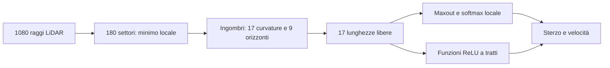

# Una rete scritta da zero, senza training

3 novembre 2026. `arc_dynamic.pt` è un nuovo attore neurale strutturato: tutti i coefficienti sono costruiti da formule geometriche e dalle equazioni del veicolo. Non contiene pesi importati dalla PPO. Riceve gli stessi 1.080 raggi LiDAR e restituisce gli stessi due comandi normalizzati; simulatore e sensori restano invariati.

È più compatta e completa più giri nel test totale, con meno contatti del corpo. **Non è più veloce sul giro: il costo medio è +8,23%.** Non viene presentata come superiore in ogni pista o condizione.

## Nuovo test congelato

21 piste × 5 nuove partenze per modello, seed 60101, 60202, 60303, 60404, 60505. Confronto con `early_smooth.zip`, il migliore candidato della fase precedente. Un giro, massimo 200 secondi, stessi punti di partenza e rumore; tutti gli insuccessi inclusi.

| Esito | PPO modificata precedente | Rete da zero |
|---|---:|---:|
| Completamenti | 95/105 | **98/105** |
| Collisioni segnalate dal simulatore | 10 | **0** |
| Timeout | 0 | **7** |
| Giri completati senza contatti raster nelle pose controllate | 89 | **98** |
| Sochi | 0/5 | **5/5** |
| Tempo sulle 92 coppie completate | riferimento | **+8,23%** |

Il candidato recupera i cinque episodi di Sochi e Monza 60303. Perde IMS 60404, Monza 60404 e YasMarina 60404: sono timeout, non giri completati. I sette timeout rimangono vicini alla posizione iniziale, con progresso inferiore all'1%; il predicato di ingombro non trova un arco praticabile. Non sono eliminati dal denominatore né conteggiati come guida sicura riuscita.

Gli hash di checkpoint e sorgenti sono congelati in `results/from_scratch/holdout_manifest.json` prima delle prove finali. Nessun coefficiente viene modificato dopo questo confronto.

## Dimensioni e costo

| Misura | Attore PPO precedente | Rete da zero |
|---|---:|---:|
| Coefficienti dell'attore | 73.474 | **28.427** |
| Memoria dei coefficienti float32 | 293.896 byte | **113.708 byte** |
| Inferenza completa `predict`, mediana locale | 55,4 µs | **49,8 µs** |
| Solo calcolo della rete, mediana locale | **31,3 µs** | 46,5 µs |

La riduzione dei coefficienti è **61,3%**. Il file TorchScript autonomo pesa 122.271 byte, circa 119,4 KiB. Il conteggio include anche tutti i tensori geometrici conservati come buffer: zero parametri addestrabili non significa zero pesi. Il critico PPO non è incluso nel confronto con l'attore.

La rete geometrica richiede più operazioni del piccolo MLP, mentre il suo adattatore completo è più semplice di quello PPO. È quindi più piccola in memoria, senza un vantaggio universale di velocità di calcolo. Latenza misurata a CPU libera, un thread, batch 1, 128 chiamate di riscaldamento e 5 × 1.000 chiamate.

## Come sono scritti i pesi



- Il minimo su ogni gruppo di sei raggi conserva gli ostacoli vicini che una media potrebbe nascondere.
- Il compilatore costruisce l'inviluppo radiale della carrozzeria **0,58 × 0,31 m**, con margine geometrico di 5 cm, lungo 17 curvature e nove orizzonti fra 0,5 e 11 m. Limita gli archi prima di compiere un giro su sé stessi.
- Gli inviluppi includono la **deriva laterale stazionaria** prevista dalle equazioni originali. La posizione dell'arco è ruotata dell'angolo β, mentre l'orientamento del corpo segue l'imbardata. Questa è la correzione che ha fatto passare i primi tre test da zero a tre completamenti.
- Affine, ReLU e max-pooling confrontano gli ingombri con lo spazio osservato. Un livello maxout sceglie una direzione; una softmax interpola soltanto le due direzioni adiacenti, evitando la media fra passaggi lontani a destra e sinistra.
- Le teste di sterzo e velocità sono funzioni a tratti scritte come coefficienti ReLU. Il programma usa 6 m/s² di decelerazione di riferimento, 7 m/s² di accelerazione laterale di riferimento e 10 m/s di velocità massima comandata. Lo sterzo è compensato con il guadagno di imbardata ricavato dalle equazioni del veicolo.

Tutta la geometria e la soluzione delle equazioni si svolgono **durante la compilazione dei pesi**. Durante l'inferenza vengono eseguite operazioni sui tensori salvati. Non c'è un pianificatore Python esterno, una mappa consultata, una raceline in ingresso, un ottimizzatore o un modello PPO nascosto.

Si segue la modalità con strumenti e feedback del [Weight-Space Programming](https://rikiyat.github.io/blog/weight-space-programming/): ipotesi sul calcolo della rete, costruzione esplicita dei coefficienti e verifica. Non è una costruzione riuscita al primo tentativo senza feedback.

## Cosa dimostra sulla generalità

Le regole non dipendono dall'identificativo della pista. I rollout di sviluppo della nuova rete usano sette piste; sulle altre **14 piste**, il test finale conta **67/70 completamenti**, contro 68/70 del precedente, con tempo appaiato +8,55%. Il nuovo modello non segnala collisioni ma ha tre timeout; uno è una regressione rispetto al precedente.

È evidenza di trasferibilità del programma geometrico, **non di superiorità generale**. Le mappe erano già note nel progetto e nelle fasi precedenti; non sono un insieme completamente sconosciuto all'intera ricerca. Non sono stati verificati nuovi pneumatici, aderenza diversa, traffico, ostacoli mobili o veicoli reali.

## Traiettorie e pareti


L'esempio Sochi 60101 è fissato prima degli esiti: il precedente collide a 24,52 s, la nuova rete completa il giro in 58,23 s. Le due lunghezze percorse non sono confrontabili come efficienza, perché il precedente non completa il giro.

Il controllo geometrico copre **tutti i 210 episodi e 1.083.184 pose**, una ogni 0,01 s. Fra i 98 giri completati della nuova rete: **zero contatti/sovrapposizioni con pixel occupati**, margine minimo del corpo circa **2,56 cm nel raster**. I sei completamenti precedenti con contatto restano nei dati.

Il nuovo modello sfrutta maggiormente la larghezza della pista: sulle 92 coppie completate, i campioni con margine sotto 10 cm passano da 0,203% a 4,814%; sotto 20 cm da 0,690% a 26,124%. Stare più vicino al muro non dimostra una traiettoria ottima e riduce la tolleranza a errori non modellati.

**Zero contatti vale solo nei giri completati.** Tre timeout nuovi (IMS 60505 e Oschersleben 60404/60505) partono già sovrapposti al muro: 60.000 pose sovrapposte restano incluse nell'audit. La geometria misura celle della mappa, non una distanza fisica continua certificata; il passo terminale dopo l'azione e il moto fra campioni non sono coperti. Restano invariati i limiti del TTC originale, che usa una lunghezza inferiore al corpo e ignora β nella proiezione della velocità.

## Tentativi e limiti

| Programma | Prove di sviluppo | Esito |
|---|---|---|
| `arc_soft`, geometria senza deriva, selezione globale | 3 | 0 completamenti, 3 collisioni |
| `arc_mode`, geometria senza deriva, selezione locale | 3 | 0 completamenti, 3 collisioni |
| `arc_dynamic`, deriva analitica | 21 | **18 completamenti, 0 collisioni, 3 timeout** |
| `arc_dynamic_pace`, riferimento laterale 8 m/s² e massimo 11 m/s | 21 | 15 completamenti, 3 collisioni, 3 timeout: scartato |

La variante più veloce perde tre episodi precedentemente riusciti; non viene usata per sostenere il risultato finale. I tre smoke test riusciti del programma dinamico sono ripetuti nella verifica da 21 episodi e non sono prove indipendenti aggiuntive.

La deriva prevista è una soluzione **a regime**, non lo stato reale: velocità e deriva istantanee non sono osservabili dal solo LiDAR. Accelerazioni e transitori cambiano le dinamiche. I valori di accelerazione laterale sono scelte di progetto, non una saturazione d'aderenza garantita dal modello, che usa forze laterali lineari. Non è dimostrato drift controllato.

La geometria ha coefficienti speculari, ma `argmax` risolve i pareggi scegliendo il primo indice. Sei casi sintetici passano; due scene simmetriche con più direzioni equivalenti mostrano un bias di sterzata. Non si dichiara simmetria globale. L'interpolazione fra archi discreti non costituisce una prova di assenza di collisione per la traiettoria risultante.

## Uso e riproduzione

- Rete pronta: `artifacts/from_scratch/arc_dynamic.pt` (TorchScript autonomo).
- Tensori espliciti: `artifacts/from_scratch/arc_dynamic_weights.pth`.
- Compilatore: `experiments/from_scratch.py`; il metodo `build('arc_dynamic')` ricostruisce i coefficienti da zero.
- Audit: `results/from_scratch_audit/arc_dynamic_audit.json`, `results/from_scratch_analysis/final_verification.json`, `results/from_scratch/final_all_footprints.json/.csv`.

```python
from experiments.from_scratch import ScriptPolicy

policy = ScriptPolicy('artifacts/from_scratch/arc_dynamic.pt')
action, _ = policy.predict(observation)  # LiDAR originale normalizzato, forma (1080,)
```

Il nuovo artefatto non è uno ZIP PPO e non si carica con `PPO.load`; il valutatore riconosce `.pt` senza cambiare il percorso precedente degli ZIP.

```bash
.venv/bin/python experiments/from_scratch.py arc_dynamic
.venv/bin/python experiments/evaluate.py --checkpoint artifacts/from_scratch/arc_dynamic.pt --maps all --seeds 60101 60202 60303 60404 60505 --state-trace --out results/from_scratch/final_candidate.json
.venv/bin/python experiments/evaluate.py --checkpoint artifacts/trajectory_v4/early_smooth.zip --maps all --seeds 60101 60202 60303 60404 60505 --state-trace --out results/from_scratch/final_previous.json
.venv/bin/python experiments/compare.py results/from_scratch/final_previous.json results/from_scratch/final_candidate.json
.venv/bin/python experiments/audit_all_footprints_v4.py --dir results/from_scratch --seeds 60101 60202 60303 60404 60505 --workers 2
.venv/bin/python experiments/audit_from_scratch.py --name arc_dynamic
```

479 ingressi verificati: modulo originale, esportazione TorchScript, adattatore e inferenza singola/batch producono risultati esattamente uguali. Originali e sorgenti upstream sono intatti. Gli artefatti precedenti sono conservati separatamente.
