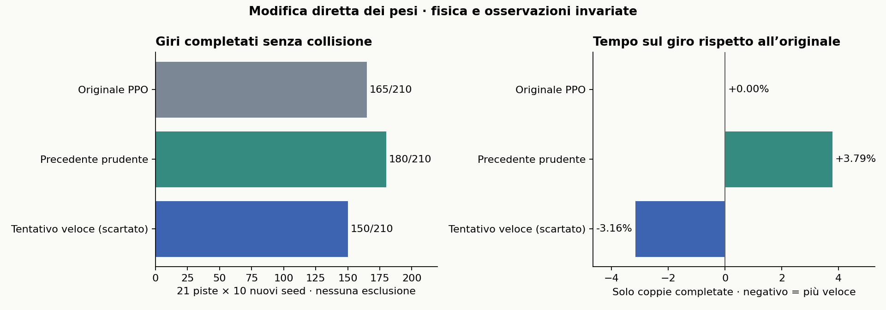

# Velocità, collisioni e drift: secondo esperimento

3 novembre 2026. Vincolo confermato: progetto attuale, solo modifiche ai pesi. **Fisica, sensori, architettura e logica di controllo esterna restano invariati.** La telemetria aggiunta non entra nella policy.

## Risultato finale

| Modello | Giri completati | Collisioni | Tempo appaiato rispetto all’originale |
|---|---:|---:|---:|
| Originale PPO | 165/210 | 45 | riferimento |
| Precedente prudente | 180/210 | 30 | +3.79% |
| Tentativo veloce, scartato | 150/210 | 60 | -3.16% |

Il confronto del nuovo modello con l’originale comprende 146 coppie completate. Recupera 4 episodi falliti dall’originale e ne perde 19 precedentemente riusciti. Rispetto al precedente prudente, la variazione di tempo sulle 150 coppie completate è -6.70%.

**L’obiettivo completo «più veloce, zero incidenti, drift controllato» non è raggiunto.** Eventuali miglioramenti di tempo non sono una garanzia di sicurezza; il modello resta sperimentale e non sostituisce automaticamente nessun checkpoint precedente.



## Modifica sottoposta al test finale, poi scartata

Sono modificati **66 parametri**, lo 0,045% dei 146.885 scalari del checkpoint. I due strati nascosti, il critico e `log_std` sono identici all’originale.

```
sterzo_nuovo = 1,02721087931901 × sterzo_originale
velocità_nuova = velocità_originale + 0,3 m/s
```

Le formule valgono prima del clipping originale. Il guadagno dello sterzo non deriva da una ricerca sui dati: si ricava dal modello dinamico single-track, affinché l’incremento di velocità mantenga approssimativamente la curvatura a regime. Se G(v) è il rapporto yaw-rate/sterzo di equilibrio, il guadagno è `(8,8/8,5) × G(8,5)/G(8,8)`. La modifica è scritta nella riga dei pesi dello sterzo e nei due bias della testa d’azione; non è applicata da un wrapper esterno.

La formula è stata verificata su 6.889 osservazioni di sviluppo. Il caricamento SB3 è verificato con 256 osservazioni per checkpoint. L’aggiunta della telemetria lascia esattamente invariati gli esiti di 15 episodi originali ripetuti.

## Esperimenti scartati e metodologia

Come nel [lavoro sul Weight-Space Programming](https://rikiyat.github.io/blog/weight-space-programming/), ogni intervento nasce da un’ipotesi sui tensori, sulle equazioni o sulle traiettorie. Nessun training, gradiente, fitting, ricerca automatica o modifica della reward.

| Programma nei pesi | Successi di sviluppo | Tempo su coppie completate |
|---|---:|---:|
| `clearance_speed` | 0/21 | — |
| `two_gate` | 9/21 | +0.11% |
| `two_gate_guard` | 1/21 | +6.56% |
| `exit_guard` | 7/21 | +0.86% |
| `geometric` | 0/21 | — |
| `curvature_compensated` | 10/21 | -3.09% |
| `straight_boost` | 9/21 | -0.58% |

L’originale completa 10/21 prove di sviluppo. La riscrittura forte della velocità destabilizza la guida; i circuiti di frenata e correzione laterale interferiscono con la policy appresa; la policy geometrica da zero non completa i circuiti. Tutti i risultati negativi e i checkpoint sono conservati. Solo il candidato a curvatura compensata è stato scelto, poi congelato, prima del confronto finale. Dopo il suo fallimento è stata tentata un’ultima modifica, `straight_boost`: mantiene il limite di frenata prudente nelle curve più strette, ma aumenta fino a +1,8 m/s il comando sui rettilinei. È stata scartata già in sviluppo (9/21 contro 10/21), senza riusare il test finale per dichiararla superiore.

Sviluppo: BrandsHatch, YasMarina, Monza, Spa, Sochi, Budapest, Oschersleben; seed 1101, 2202, 3303. Test finale: tutte le 21 piste, seed 20001, 21002, 22003, 23004, 24005, 25006, 26007, 27008, 28009, 29010. Sono nuove partenze e nuovo rumore LiDAR, non nuove piste. Il test finale contiene 630 episodi complessivi per i tre modelli; aggiungendo lo sviluppo, questa fase comprende 798 episodi. Il checkpoint a curvatura compensata non è stato modificato dopo il test finale. È una sequenza di interventi ragionati con feedback del simulatore, non una riproduzione dell’esperimento one-shot dell’articolo.

## Drift: cosa è stato realmente misurato

Si misura lo stato dinamico interno β, insieme a velocità, sterzo e yaw rate. Un indicatore diagnostico richiede `|β|≥5°`, velocità ≥3 m/s, sterzo di segno contrario allo yaw rate per almeno 0,5 s consecutivi, e completamento dell’episodio. Non è, da solo, una prova di drift pneumatico.

Con il nuovo modello, episodi completati che soddisfano questo indicatore: **0**. Il massimo intervallo di controsterzo con deriva negli episodi completati è **0.13 s**. I picchi di β non vengono presentati come drift controllato.

Il modello fisico attuale usa forze laterali linearizzate e non contiene saturazione combinata dei pneumatici né velocità angolari delle ruote. L’analisi di equilibrio a sette velocità fra 3 e 20 m/s, con accelerazione nulla, trova equilibri stabili con yaw rate dello stesso segno dello sterzo: nessun equilibrio di controsterzo nei casi controllati. Questo non è un teorema che esclude qualsiasi transitorio; mostra perché la sola sbandata numerica non certifica il comportamento richiesto.

La rete riceve una singola scansione LiDAR: velocità, β e yaw rate non sono osservati. Stati con identica posa e scansione ma diversa deriva ricevono la stessa azione. Su richiesta dell’utente non sono stati aggiunti sensori, memoria o nuovi modelli fisici.

Riferimenti del simulatore: [dinamica e stato single-track](https://f1tenth-gym.readthedocs.io/en/v1.0.0/api/dynamic_models.html), [parametri fisici](https://f1tenth-gym.readthedocs.io/en/stable/customized_usage.html). La diagnosi usa il codice locale effettivamente eseguito, non versioni differenti del simulatore.

## Partenze e limiti

Tutte le partenze sono conservate nei denominatori. Un controllo indipendente della mappa trova già occupato dal muro circa il 20,8% dei 510 punti campionati nell’impronta iniziale del veicolo a YasMarina, seed 2202. Altre collisioni avvengono dopo aver guidato: non vengono attribuite automaticamente alle partenze.

Successo: almeno il 99% dei waypoint ordinati più passaggio sulla linea di partenza, senza collisione. Limite 200 secondi simulati, un giro, RK4 e passo 0,01 s. Nessuna prova su hardware o gare di più giri. Tempi confrontati solo sugli episodi completati da entrambi; nessuna esclusione di fallimenti per far apparire più veloce un modello.

## Dettaglio per pista

| Pista | Originale | Prudente | Nuovo | Tempo nuovo/originale |
|---|---:|---:|---:|---:|
| Austin | 9/10 | 9/10 | 9/10 | -3.04% |
| BrandsHatch | 10/10 | 10/10 | 10/10 | -3.23% |
| Budapest | 2/10 | 9/10 | 2/10 | — |
| Catalunya | 10/10 | 10/10 | 10/10 | -3.12% |
| Hockenheim | 10/10 | 10/10 | 10/10 | -3.43% |
| IMS | 5/10 | 5/10 | 5/10 | -3.14% |
| Melbourne | 10/10 | 10/10 | 10/10 | -3.22% |
| MexicoCity | 10/10 | 10/10 | 10/10 | -3.14% |
| Monza | 6/10 | 6/10 | 2/10 | -2.87% |
| MoscowRaceway | 10/10 | 10/10 | 4/10 | -3.11% |
| Nuerburgring | 10/10 | 10/10 | 10/10 | -3.23% |
| Oschersleben | 0/10 | 4/10 | 0/10 | — |
| Sakhir | 10/10 | 10/10 | 10/10 | -3.13% |
| SaoPaulo | 10/10 | 10/10 | 10/10 | -3.09% |
| Sepang | 9/10 | 9/10 | 9/10 | -3.06% |
| Silverstone | 10/10 | 10/10 | 10/10 | -3.14% |
| Sochi | 0/10 | 0/10 | 0/10 | — |
| Spa | 6/10 | 10/10 | 4/10 | -3.22% |
| Spielberg | 10/10 | 10/10 | 10/10 | -3.25% |
| YasMarina | 8/10 | 8/10 | 5/10 | -3.08% |
| Zandvoort | 10/10 | 10/10 | 10/10 | -3.11% |

## Artefatti e riproduzione

- [Checkpoint sperimentale (manifest)](artifacts/racing_v2/curvature_compensated.json) e [manifest](artifacts/racing_v2/curvature_compensated.json).
- [Confronto finale](results/racing_v2/comparison_curvature.json), [drift](results/racing_v2/drift_summary.json), [verifiche](results/racing_v2/verification.json).
- [Programmi dei pesi](experiments/racing_weights.py), [audit riproducibile](experiments/audit_racing.py).
- Gli optimizer storici negli ZIP sono conservati: artefatti per inferenza; reinizializzarli prima di eventuale training futuro.

```bash
.venv/bin/python experiments/racing_weights.py curvature_compensated
.venv/bin/python experiments/audit_racing.py
.venv/bin/python experiments/evaluate.py --checkpoint artifacts/racing_v2/curvature_compensated.zip --maps all --seeds 20001 21002 22003 23004 24005 25006 26007 27008 28009 29010 --out results/racing_v2/final_curvature.json
.venv/bin/python experiments/summarize_racing.py
```
