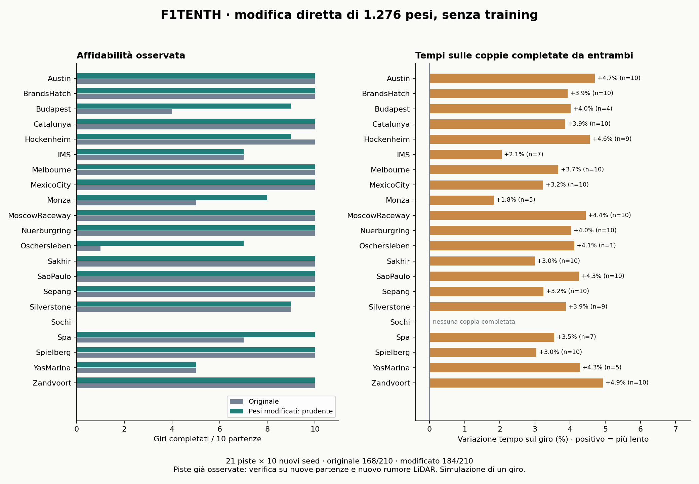

# Risultati — 3 novembre 2026

## Esito

Modifica diretta dei pesi eseguita e verificata. La rete non è troppo grande: attore da 73.474 parametri, checkpoint da 146.885. Due candidati analitici, 1.276 scalari modificati ciascuno; nessun riaddestramento.

| Confronto | Originale | Modificato | Tempo sulle coppie completate |
|---|---:|---:|---:|
| Primo candidato, sviluppo | 17/20 | 17/20 | -1.68% |
| Primo candidato, 17 altre piste | 67/85 | 66/85 | -1.91% |
| Candidato prudente, sviluppo | 17/20 | 17/20 | +3.87% |
| **Candidato prudente, verifica finale** | **168/210** | **184/210** | **+3.77%** |

Nella verifica finale: collisioni 42 → 26; timeout 0 → 0. Episodi recuperati: 17; episodi precedentemente riusciti ma persi: 1. Tempi confrontati su 167 coppie completate da entrambi.

Il primo candidato accelera ma peggiora il saldo dei completamenti, quindi non è un miglioramento complessivo. Il secondo va giudicato come compromesso fra completamento e tempo: i dati non dimostrano una policy universalmente superiore. Il checkpoint originale resta il riferimento; nessuna sostituzione automatica.

## Come sono stati modificati i pesi

Due neuroni quasi costanti nelle tracce di sviluppo vengono riutilizzati per un circuito che legge la distanza LiDAR frontale. Il loro precedente contributo viene trasferito nei bias successivi. Nel secondo candidato il circuito riduce fino a 0,6 m/s il comando quando lo spazio davanti è piccolo, e aggiunge fino a 0,3 m/s con spazio ampio. È tutto nei tensori della rete, senza logica di controllo aggiuntiva esterna.

La modifica riguarda lo 0,869% del checkpoint (1,737% dell'attore). Critico e deviazione standard delle azioni sono identici. I dettagli matematici, gli script e i comandi sono in [README.md](README.md); gli hash e il dettaglio dei tensori in [artifacts/clearance_cautious.json](artifacts/clearance_cautious.json).

## Verifica finale per pista

| Pista | Originale | Prudente | Variazione tempo appaiata |
|---|---:|---:|---:|
| Austin | 10/10 | 10/10 | +4.71% |
| BrandsHatch | 10/10 | 10/10 | +3.93% |
| Budapest | 4/10 | 9/10 | +4.02% |
| Catalunya | 10/10 | 10/10 | +3.86% |
| Hockenheim | 10/10 | 9/10 | +4.56% |
| IMS | 7/10 | 7/10 | +2.06% |
| Melbourne | 10/10 | 10/10 | +3.66% |
| MexicoCity | 10/10 | 10/10 | +3.23% |
| Monza | 5/10 | 8/10 | +1.83% |
| MoscowRaceway | 10/10 | 10/10 | +4.44% |
| Nuerburgring | 10/10 | 10/10 | +4.03% |
| Oschersleben | 1/10 | 7/10 | +4.12% |
| Sakhir | 10/10 | 10/10 | +2.99% |
| SaoPaulo | 10/10 | 10/10 | +4.26% |
| Sepang | 10/10 | 10/10 | +3.24% |
| Silverstone | 9/10 | 9/10 | +3.88% |
| Sochi | 0/10 | 0/10 | — |
| Spa | 7/10 | 10/10 | +3.55% |
| Spielberg | 10/10 | 10/10 | +3.04% |
| YasMarina | 5/10 | 5/10 | +4.28% |
| Zandvoort | 10/10 | 10/10 | +4.94% |

## Limiti e controlli

- Le 210 partenze finali non sono state usate per scegliere i pesi. Le piste erano già osservate nella prima verifica e già disponibili nel training storico: non sono un test su piste sconosciute.
- Le partenze e il rumore LiDAR sono appaiati; nessuna esclusione di incidenti immediati. Successo: almeno 99% dei waypoint in ordine più passaggio sulla linea di partenza, senza collisione. Limite 200 secondi, un giro.
- È un nuovo benchmark locale: la relazione storica usa 19 piste, qui ci sono 21 raceline. Python, NumPy e Gym differiscono dall'ambiente storico; le comparazioni sono valide all'interno di questo setup, non una replica numerica del paper.
- Verificata equivalenza esatta delle azioni con `PPO.load` su 128 osservazioni per checkpoint. Due episodi originali ripetuti producono risultati identici. Solo `policy.pth` cambia negli archivi; gli originali sono intatti.
- Nessun test su veicolo reale, ROS, più giri o avversari. Gli ZIP sono per inferenza; prima di nuovo training va reinizializzato lo stato dell'optimizer conservato nell'archivio.
- Il numero di episodi per pista è limitato e le partenze sulla stessa pista sono correlate. Non si pretende una garanzia statistica di superiorità generale.

## File utili

- [Checkpoint prudente (manifest)](artifacts/clearance_cautious.json)
- [Checkpoint veloce, candidato non promosso (manifest)](artifacts/clearance_gate.json)
- [Confronto finale JSON](results/final_comparison.json)
- [Episodi originali](results/final_baseline.json) / [episodi modificati](results/final_cautious.json)
- [Verifiche](results/verification_cautious.json)
- [Relazione originale LaTeX](https://github.com/zucchero-sintattico/svs-f1tenth_gym/blob/9381a13eec6b182ff38e4fba55a105cf94219da6/report/index.tex)
- [Riferimento metodologico](https://rikiyat.github.io/blog/weight-space-programming/)
