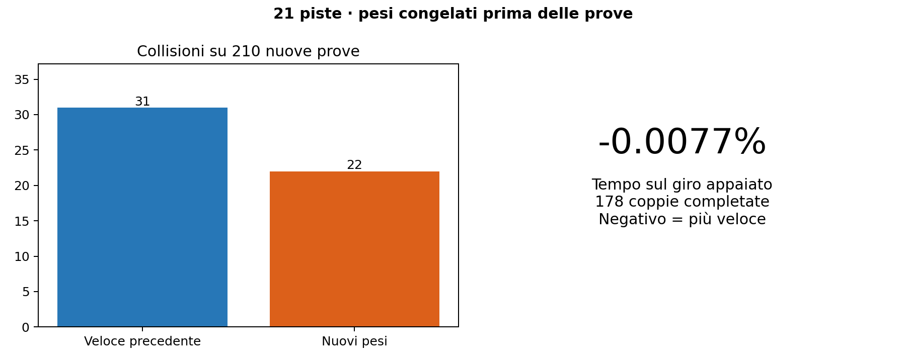

# Pesi e traiettorie — quarta fase

3 novembre 2026. Il confronto riguarda il candidato congelato `early_smooth` e il veloce precedente `wall_panic_fast`. Tutti i risultati qui sotto provengono dalle nuove partenze 50101–51010, salvo le sezioni esplicitamente di sviluppo. Non sono nuove piste.

## Risultato finale

| Modello | Giri completati | Collisioni | Tempo appaiato |
|---|---:|---:|---:|
| Veloce precedente | 179/210 | 31 | riferimento |
| Nuovi pesi | 188/210 | 22 | -0.0077% |

Collisioni: -29.03%. Il candidato recupera 10 episodi e ne perde 1 rispetto al precedente. Il tempo è confrontato sulle **178 coppie completate**, mai usando un crash come giro breve. Intervallo descrittivo bootstrap delle medie per pista: -0.0297% … +0.0318%; non è una garanzia su piste o partenze future.

**Il controllo del corpo completo ridimensiona il risultato di sicurezza:** tra i giri dichiarati completati, 7 precedenti e 11 nuovi hanno contatti/sovrapposizioni con pixel occupati. I giri completati **senza contatto nei campioni registrati** sono quindi **172 → 177**, con tempo -0.0037% sulle 170 coppie così filtrate. È una diagnostica secondaria, non una ridefinizione a posteriori del successo congelato, e non certifica l'intero moto continuo.

Collisioni entro 0,10 s: precedente 6, candidato 6; sono mantenute nel denominatore. I risultati per pista, inclusi Sochi e le partenze difficili, non vengono esclusi.



## Modifiche effettive

Si mantiene l'architettura 1080→64→64→2, con il solo LiDAR originale. Due interventi espliciti:

1. La soglia del predicato di parete sinistra passa da 0,4 a 0,6 m. Nei fallimenti osservati la sterzata estrema iniziava prima dell'intervento precedente. La correzione resta condizionata alla combinazione interna di sterzo, non forza l'auto al centro pista.
2. Le sole righe 1, 14, 41, 61 del primo strato appreso ricevono un filtro angolare gaussiano di 2 raggi (circa 0,5°), incorporato nei coefficienti. La riga del nuovo predicato del muro resta intatta. Non c'è un filtro esterno o memoria temporale.

Cambiano **4.321 scalari rispetto al veloce precedente**, 5.596 rispetto all'originale storico (3,81% dei 146.885 scalari totali). Critico, `log_std`, architettura, fisica, sensori e normalizzazione restano invariati.

La testa di velocità non è riscritta; il filtro degli strati condivisi cambia anche le sue attivazioni. Sulle 9.319 osservazioni di sviluppo, variazione assoluta media della velocità comandata 0,01046 m/s, percentile 99 0,08263 m/s. Per questo la conservazione del passo si misura con i giri appaiati, non si deduce dalla sola testa invariata.

## Traiettorie e muri

Le pose sono registrate a ogni passo fisico (0,01 s), senza darle in ingresso alla rete. L'audit geometrico misura il rettangolo completo **0,58 × 0,31 m** rispetto ai pixel occupati della mappa, includendo rotazione e spigoli. La distanza del centro da sola sovrastima il margine disponibile.

Coorte primaria fissata prima dei risultati: seed 50101 su tutte le 21 piste, entrambi i modelli, con tutti i fallimenti. Nelle 17 coppie completate:

- Lunghezza percorsa media appaiata: +0.0072%.
- Cambiamento medio del quinto percentile del margine del corpo: +0.403 cm.
- Cambiamento medio del 95° percentile dello scarto dalla raceline: -0.602 cm.


Budapest, Monza e Spa e lo zoom sulla curva di massima curvatura sono stati scelti prima degli esiti. I rettangoli mostrano l'ingombro dell'auto. La raceline del progetto è un riferimento: **non si dimostra una traiettoria globalmente ottima**, né stare più vicino al muro ovunque significa andare più veloce. Il margine in centimetri dipende anche dalla risoluzione della mappa. Il campione dopo l'ultimo passo terminale non è salvato.

Le statistiche complete sono in `final_geometry_seed50101.json`. L'audit aggiuntivo `final_all_footprints.json/.csv` esamina **420 episodi e 1,774,769 pose**, senza esclusioni. Fra le 178 coppie completate, entrambi i modelli presentano contatti raster in 6 episodi (i casi non sono tutti identici), con 23 contro 25 pose di contatto. Un contatto raster non misura la profondità della penetrazione.

Il codice originale `base_classes.py` calcola la semilunghezza TTC come `(lf+lr)/2`: il rilevatore di parete tratta una lunghezza di **0,3302 m**, mentre il corpo dichiarato è lungo **0,58 m**. Inoltre proietta la velocità ignorando l'angolo di deriva. Per questo collisioni del simulatore e contatto geometrico del corpo sono misure distinte; la risoluzione raster introduce un'ulteriore differenza. Nessuna modifica alla fisica o al rilevatore e nessuna dichiarazione di drift controllato. Dettagli e verifiche in `geometry_findings.md`.

## Sviluppo e tentativi scartati

Metodo del [Weight-Space Programming](https://rikiyat.github.io/blog/weight-space-programming/) con strumenti e feedback: lettura di pesi e attivazioni, ipotesi meccanistica, modifica esplicita dei tensori, verifica. Nessun training, fitting, gradiente, ottimizzatore o ricerca automatica dei valori.

| Ipotesi | Completamenti, precedente 12/21 | Tempo appaiato |
|---|---:|---:|
| `early_panic` | 14/21 | +0.012% |
| `exit_support` | 0/21 | — |
| `exit_only` | 0/21 | — |
| `exit_approach` | 14/21 | +0.313% |
| `early_smooth` | 15/21 | +0.109% |
| `turn_preview` | 12/21 | -0.894% |

Le correzioni generiche vicino al muro intervengono anche nella guida normale e falliscono. Aggiungere una condizione di avvicinamento alla parete ne migliora la specificità ma non il compromesso finale; anticipare le curve destre accorcia alcuni giri ma introduce regressioni. Nessuno di questi modelli viene scelto.

`early_panic` ed `early_smooth` sono poi confrontati sulle 210 partenze già note della fase precedente: entrambi 184/210 contro 180, quattro recuperi senza perdite. Tempo rispettivamente +0,01255% e +0,000846%. Questi dati sono sviluppo, non il risultato finale. `early_smooth` è scelto e gli hash congelati prima delle nuove prove. Nessun peso viene modificato dopo il congelamento.

## Per pista nel nuovo test

| Pista | Precedente | Candidato | Tempo appaiato |
|---|---:|---:|---:|
| Austin | 9/10 | 9/10 | +0.090% |
| BrandsHatch | 10/10 | 10/10 | -0.010% |
| Budapest | 9/10 | 10/10 | +0.014% |
| Catalunya | 10/10 | 10/10 | +0.010% |
| Hockenheim | 10/10 | 10/10 | +0.029% |
| IMS | 8/10 | 8/10 | +0.000% |
| Melbourne | 10/10 | 10/10 | -0.024% |
| MexicoCity | 10/10 | 10/10 | +0.031% |
| Monza | 3/10 | 7/10 | +0.101% |
| MoscowRaceway | 9/10 | 10/10 | -0.181% |
| Nuerburgring | 10/10 | 10/10 | -0.031% |
| Oschersleben | 9/10 | 9/10 | -0.019% |
| Sakhir | 9/10 | 10/10 | -0.072% |
| SaoPaulo | 10/10 | 10/10 | -0.012% |
| Sepang | 10/10 | 10/10 | -0.020% |
| Silverstone | 10/10 | 10/10 | +0.013% |
| Sochi | 0/10 | 0/10 | — |
| Spa | 8/10 | 10/10 | +0.050% |
| Spielberg | 10/10 | 10/10 | -0.062% |
| YasMarina | 5/10 | 5/10 | +0.164% |
| Zandvoort | 10/10 | 10/10 | -0.053% |

## Riproduzione e verifiche

Il generatore è `experiments/trajectory_weights.py`. Audit indipendente: `results/trajectory_v4_analysis/early_smooth_verification.json`, con convoluzione NumPy indipendente esattamente uguale ai tensori, caricamento PPO/evaluator identico su 9.319 input, critico e metadati ZIP invariati. La nuova registrazione delle pose riproduce esattamente i risultati precedenti su tre episodi di controllo.

```bash
.venv/bin/python experiments/trajectory_weights.py early_smooth
.venv/bin/python experiments/evaluate.py --checkpoint artifacts/trajectory_v4/early_smooth.zip --maps all --seeds 50101 50202 50303 50404 50505 50606 50707 50808 50909 51010 --state-trace --out results/trajectory_v4/final_candidate.json
.venv/bin/python experiments/summarize_trajectories_v4.py
.venv/bin/python experiments/audit_all_footprints_v4.py
.venv/bin/python experiments/summarize_weights_v4.py
```

Ripetere l'evaluatore anche con `artifacts/ultra/wall_panic_fast.zip`, output `final_previous.json`, prima dei due riepiloghi. Il checkpoint resta per inferenza; conserva lo stato storico dell'ottimizzatore, da reinizializzare se in futuro si decide di fare training. Nessun file sorgente upstream modificato.
