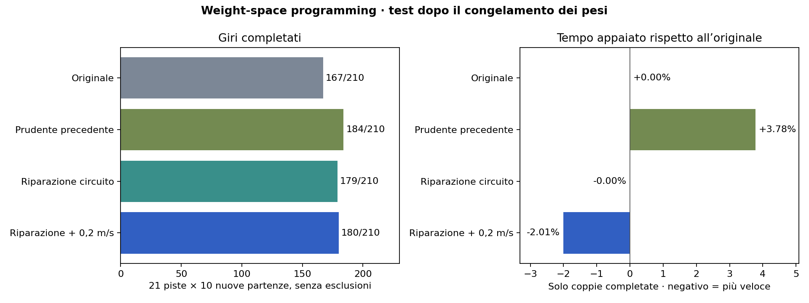

# Riparazione di un circuito nei pesi — terza fase

3 novembre 2026. Nel test il candidato primario migliora sia i completamenti sia il tempo appaiato rispetto all’originale. **Zero incidenti e drift controllato non sono dimostrati.**

## Confronto finale

| Modello | Completamenti | Collisioni | Tempo appaiato rispetto all’originale |
|---|---:|---:|---:|
| Originale | 167/210 | 43 | riferimento |
| Prudente precedente | 184/210 | 26 | +3.78% |
| Riparazione, velocità invariata | 179/210 | 31 | -0.00% |
| Riparazione +0,2 m/s, candidato primario | 180/210 | 30 | -2.01% |

Il candidato primario recupera 16 episodi falliti dall’originale e ne perde 3 precedentemente riusciti. Il tempo è confrontato sulle 164 coppie completate. Il circuito senza aumento di velocità recupera 16 episodi e ne perde 4; serve come confronto per isolare l’effetto della riparazione.



## Cosa è stato individuato nei pesi

L’analisi indipendente degli strati e delle traiettorie trova quattro neuroni del primo strato particolarmente variabili: 1, 14, 41, 61. La combinazione h41 positivo e h61 negativo partecipa alle sterzate positive estreme. Non tutte sono dannose: alcune appartengono a tornanti completati. Nei campioni terminali problematici esaminati, la parete sinistra è però a circa 0,26–0,32 m, mentre nei campioni di sterzata estrema completati la distanza minima è 0,441 m.

Il nuovo circuito interviene solo sulla combinazione richiesta di sterzo positivo + parete sinistra molto vicina. Non simmetrizza l’intera rete e non sostituisce il controller appreso.

```
dL = media LiDAR dei raggi 880:920 (circa perpendicolari a sinistra)
h15_nuovo = tanh((0,4 - dL) / 0,05)
g = tanh(4 * (h15_nuovo + h41 - h61 - 2))
sterzo_nuovo ≈ sterzo_originale - 0,35 * (1 + g)
velocità_nuova ≈ velocità_originale + 0,2 m/s
```

La soglia del predicato è il punto medio fra la combinazione vera (+3) e una condizione falsa (≤+1) per segnali tanh saturi. Il margine spaziale di 0,4 m comprende la semilarghezza di 0,155 m più margine. La scelta è motivata dalla geometria osservata nello sviluppo, non da fitting o scansioni automatiche di parametri; la generalizzazione va giudicata solo dal confronto finale.

Le formule sono implementate riutilizzando due neuroni quasi costanti e compensando il loro vecchio contributo nei bias successivi. L’architettura resta 1080→64→64→2. Cambiano **1.276 scalari (0,869% del checkpoint)**; critico e `log_std` restano identici. Gli input, il simulatore e la normalizzazione non cambiano. Le formule sono prima del clipping originale, con un piccolo residuo di compensazione verificato.

## Verifiche indipendenti

Su 6.889 osservazioni di sviluppo: equivalenza esatta delle predizioni con `PPO.load`; formula dei tensori entro 8,7e−7 normalizzato; il candidato veloce ha sterzo bit-identico al circuito non accelerato e differisce da esso per un solo bias (+0,016 normalizzato = +0,2 m/s). Tutte le voci ZIP tranne `policy.pth` sono identiche all’originale. Audit e script sono in `results/ultra_analysis/`.

Gli hash dei quattro checkpoint sono fissati in `results/ultra/holdout_manifest.json` prima delle prove finali e verificati contro gli output. Nessun peso è stato modificato dopo il test finale.

## Metodo e tentativi di sviluppo

Si segue la modalità con strumenti e feedback del [Weight-Space Programming](https://rikiyat.github.io/blog/weight-space-programming/): lettura dei tensori, ipotesi meccanistiche, modifica esplicita dei pesi e rollout. Nessun training, gradiente, fitting, ottimizzatore o ricerca automatica dei valori.

| Intervento | Successi (originale 10/21) | Tempo appaiato |
|---|---:|---:|
| `angular_smooth` | 11/21 | -0.063% |
| `panic_gate` | 12/21 | +0.067% |
| `wall_panic` | 13/21 | -0.053% |
| `wall_panic_fast` | 12/21 | -2.030% |

Due ipotesi sono scartate prima dei rollout: dimezzare la temperatura dei quattro neuroni introduce un bias sinistro e riduce la velocità; recuperare la testa di sterzo dal vecchio checkpoint YasMarina aumenta i picchi. Il filtro angolare da solo migliora leggermente i completamenti ma non la velocità. Il predicato solo interno colpisce anche alcune sterzate utili: aggiungere la distanza dal muro restringe l’intervento.


L’esempio mostra Budapest, seed 1101, nel gruppo di sviluppo: non è una prova indipendente di generalizzazione.

## Protocollo e limiti

- Sviluppo: le stesse sette piste difficili della seconda fase, seed 1101, 2202, 3303. Il candidato primario è scelto per miglioramento simultaneo di tempo e completamenti sullo sviluppo, prima del test finale.
- Test finale: 21 piste ×10 seed nuovi, 40101, 40202, 40303, 40404, 40505, 40606, 40707, 40808, 40909, 41010. Sono nuove partenze/rumore, non piste mai osservate. Quattro checkpoint, 840 episodi finali; 84 ulteriori episodi di sviluppo per i quattro candidati.
- Il successo richiede ≥99% waypoint ordinati e attraversamento della partenza, senza collisione; massimo 200 s simulati, un giro. Tutti i fallimenti sono inclusi. Il confronto della velocità è condizionato al completamento di entrambi, non include i crash come giri veloci.
- Partenze problematiche non eliminate: nel gruppo finale l’originale conta 13 collisioni entro 0,10 s, il primario 13.
- Nessuna garanzia di zero incidenti, superiorità universale, robustezza su più giri o comportamento su un veicolo reale.

## Drift

Nessun drift controllato viene dichiarato. Nel primario, episodi completati con |β|≥5°, v≥3m/s e controsterzo continuo per almeno 0,5 s: **0**. Il massimo tratto così misurato negli episodi completati è 0.14 s; anche un eventuale risultato positivo sarebbe solo un indicatore diagnostico.

Il modello usa forze laterali linearizzate e manca della dinamica di ruote/slittamento necessaria a certificare il drift pneumatico. Inoltre il rilevatore originale `check_ttc_jit` proietta la velocità come `v*cos(ray_angle)`, ignorando β, mentre il moto segue heading+β. Quindi anche l’interpretazione delle collisioni in forte deriva è limitata. Questa fase mantiene tutti questi componenti invariati, come richiesto. Non si sfrutta il difetto per dichiarare un drift riuscito.

## Per pista

| Pista | Originale | Prudente | Circuito | Circuito veloce | Tempo veloce/originale |
|---|---:|---:|---:|---:|---:|
| Austin | 9/10 | 9/10 | 9/10 | 9/10 | -2.00% |
| BrandsHatch | 10/10 | 10/10 | 10/10 | 10/10 | -2.01% |
| Budapest | 2/10 | 10/10 | 10/10 | 10/10 | -2.16% |
| Catalunya | 10/10 | 10/10 | 10/10 | 10/10 | -1.99% |
| Hockenheim | 10/10 | 10/10 | 10/10 | 10/10 | -2.10% |
| IMS | 4/10 | 4/10 | 4/10 | 4/10 | -2.05% |
| Melbourne | 10/10 | 10/10 | 10/10 | 10/10 | -2.00% |
| MexicoCity | 10/10 | 10/10 | 10/10 | 10/10 | -1.97% |
| Monza | 7/10 | 8/10 | 5/10 | 6/10 | -1.84% |
| MoscowRaceway | 10/10 | 10/10 | 10/10 | 9/10 | -2.12% |
| Nuerburgring | 10/10 | 10/10 | 10/10 | 10/10 | -2.03% |
| Oschersleben | 2/10 | 7/10 | 7/10 | 7/10 | -2.53% |
| Sakhir | 10/10 | 10/10 | 10/10 | 10/10 | -2.04% |
| SaoPaulo | 10/10 | 10/10 | 10/10 | 10/10 | -2.00% |
| Sepang | 10/10 | 10/10 | 10/10 | 10/10 | -2.00% |
| Silverstone | 10/10 | 10/10 | 10/10 | 10/10 | -1.99% |
| Sochi | 0/10 | 0/10 | 0/10 | 0/10 | — |
| Spa | 6/10 | 9/10 | 7/10 | 8/10 | -1.93% |
| Spielberg | 10/10 | 10/10 | 10/10 | 10/10 | -1.98% |
| YasMarina | 7/10 | 7/10 | 7/10 | 7/10 | -2.01% |
| Zandvoort | 10/10 | 10/10 | 10/10 | 10/10 | -1.93% |

## File e comandi

- [Checkpoint primario sperimentale (manifest)](artifacts/ultra/wall_panic_fast.json), [circuito senza accelerazione (manifest)](artifacts/ultra/wall_panic.json).
- [Confronto finale](results/ultra/comparison_fast.json), [confronto senza accelerazione](results/ultra/comparison_wall.json).
- [Generatore dei pesi](experiments/ultra_weights.py), [audit del candidato](results/ultra_analysis/fast_verification.json).
- Gli originali sono intatti. Gli ZIP sono per inferenza: conservano lo stato storico dell’optimizer, da reinizializzare prima di eventuale training.

```bash
.venv/bin/python experiments/ultra_weights.py wall_panic
.venv/bin/python experiments/ultra_weights.py wall_panic_fast
.venv/bin/python experiments/evaluate.py --checkpoint artifacts/ultra/wall_panic_fast.zip --maps all --seeds 40101 40202 40303 40404 40505 40606 40707 40808 40909 41010 --out results/ultra/final_fast.json
.venv/bin/python experiments/summarize_ultra.py
```
